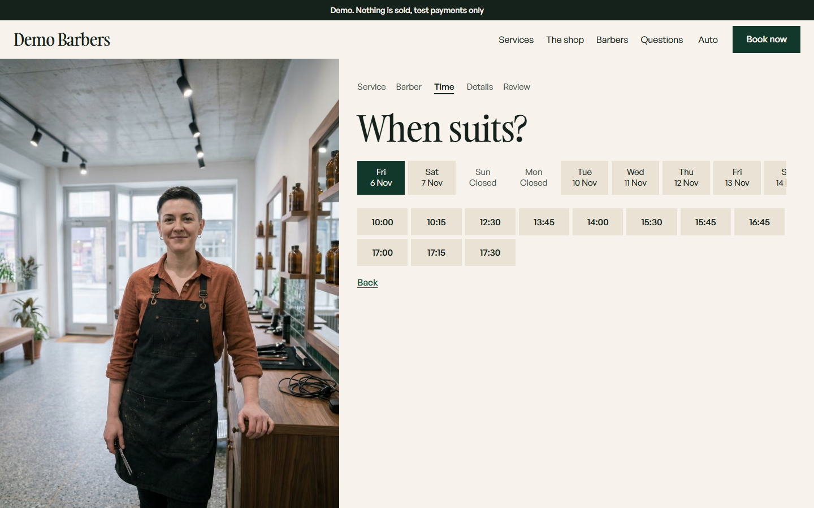
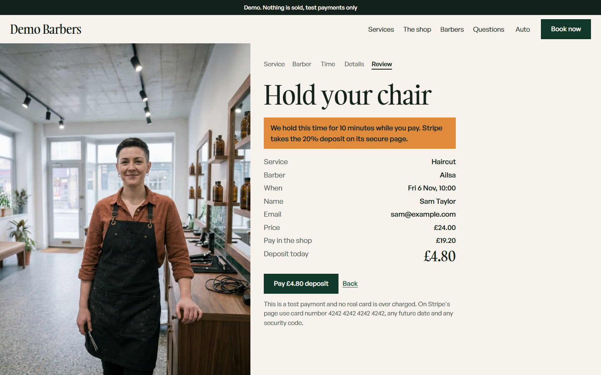
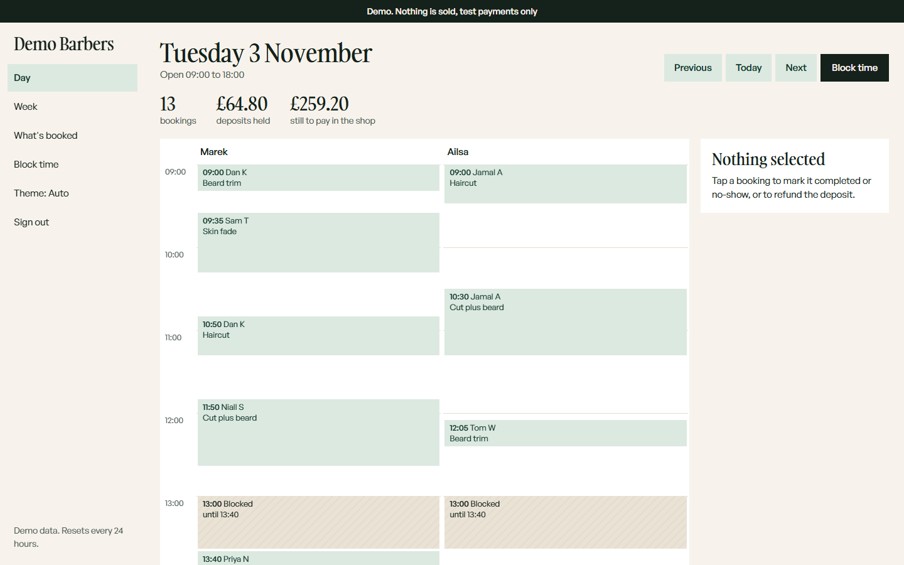
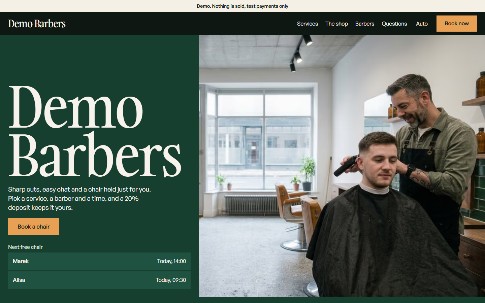
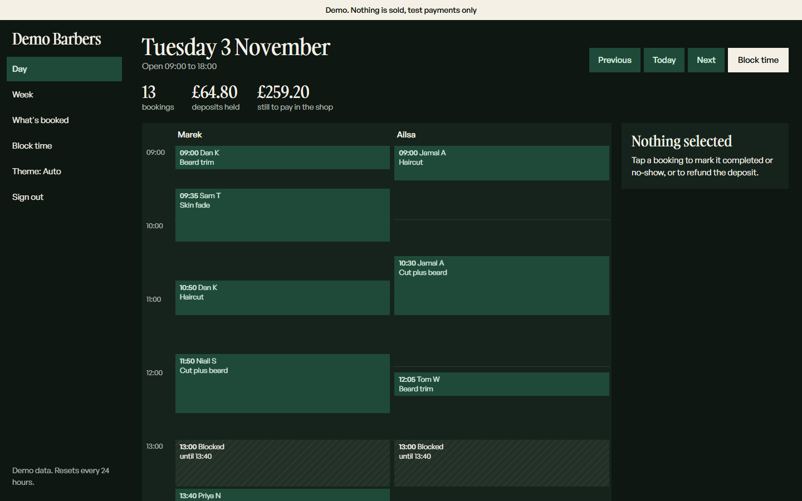
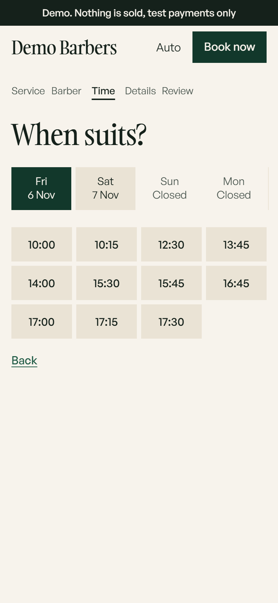

# Demo Barbers

Demo Barbers is a fictional British barber shop, built as a portfolio demo of online booking with a deposit. It sells nothing and takes no real money. Payments run on Stripe's test mode only, and every page says "Demo. Nothing is sold, test payments only". Visitors pick a service, a barber and a time, pay a 20% deposit, and get a private link to cancel or move the booking. It sends no emails. The shop's side is a diary where the owner sees the day, marks bookings completed or as no-shows, and refunds deposits. The shop, the barbers and the prices are invented, and every photo is AI-generated and labelled as such.

A portfolio project by Cameron Pittaway. I made the product, design and business decisions.

## Live demo

https://demo-barbers-uk.vercel.app

This public repository is a fresh copy of the finished code; the full build history is kept privately.

## Try it

- Book a chair, then pay with the test card `4242 4242 4242 4242`, any future expiry date and any CVC. No real card is ever charged.
- After paying you get a private link, shown on screen with a copy button. Use it to cancel (the deposit is refunded up to 24 hours before) or to move to another time. The demo sends no emails, because visitors can type any address; a real shop would email the link.
- Press **Try the admin** at the foot of the home page to open the shop's diary as a demo visitor. The diary is full of made-up bookings that reset by themselves. Real visitors' bookings show only as "A visitor".

## Screenshots

<table>
  <tr>
    <td align="center" width="50%">
      
      <br><sub>Home</sub>
    </td>
    <td align="center" width="50%">
      
      <br><sub>Choosing a time</sub>
    </td>
  </tr>
  <tr>
    <td align="center" width="50%">
      
      <br><sub>Review before paying the deposit</sub>
    </td>
    <td align="center" width="50%">
      
      <br><sub>The shop's diary (demo visitor)</sub>
    </td>
  </tr>
  <tr>
    <td align="center" width="50%">
      
      <br><sub>Dark theme</sub>
    </td>
    <td align="center" width="50%">
      
      <br><sub>Diary, dark theme</sub>
    </td>
  </tr>
  <tr>
    <td align="center" width="50%">
      
      <br><sub>Phone: home</sub>
    </td>
    <td align="center" width="50%">
      
      <br><sub>Phone: choosing a time</sub>
    </td>
  </tr>
</table>

## Features

- Four services from £16 to £36 with two barbers, bookable in 15-minute steps up to 14 days ahead, Tuesday to Saturday, 09:00 to 18:00 (Europe/London).
- A 20% deposit through Stripe Checkout in test mode. The time is held for 10 minutes while the visitor fills in their details and pays, and the deposit comes off the bill.
- Double bookings are impossible: the database itself refuses two bookings for one barber that overlap, so two visitors racing for the same time cannot both win.
- No accounts for customers. A signed private link, shown after paying, lets them cancel with a refund up to 24 hours before, or move to another time with the deposit carried over.
- The shop's diary: a day and week view, bookings marked completed or as no-shows, deposits refunded, and time blocked off. A one-press demo sign-in shows the diary to visitors with tight limits on what they can change.
- Light and dark themes that follow the device, with a switch, and a phone layout. Automated accessibility checks run in both themes at phone and desktop widths.
- Every booking and its details are deleted after 24 hours by an hourly clean-up job.

## How booking works

1. The visitor picks a service, a barber and a time. Free times are worked out from opening hours, existing bookings and blocks.
2. On **Pay deposit**, the time is held in the database and the visitor goes to Stripe's hosted checkout.
3. Stripe tells the site the payment succeeded through a signed webhook. The site checks the payment with Stripe again before confirming, and confirms each booking exactly once.
4. The confirmation page shows the private link to save. Expired holds are released inside the booking transaction itself, so the diary stays correct even if no scheduled job runs.

## Stack

| Part | What is used |
|---|---|
| Framework | Next.js 16.4.3, React 19.2.8, TypeScript 5.9.3 |
| Styling | Plain CSS with design tokens |
| Sign-in (shop diary only) | Better Auth 1.7.15 |
| Database | Neon Postgres, London, through Drizzle ORM 0.45.4 and `pg` |
| Payments | Stripe 23.1.0, sandbox (test mode) only, hosted Checkout and webhooks |
| Hosting | Vercel Hobby (free plan), functions in London |
| Scheduled clean-up | GitHub Actions, hourly, with a daily Vercel job as a backstop |
| Tests | Vitest 5.0.4, Playwright 1.64.0 with axe-core 4.13.0, Lighthouse 13.5.0 |
| Photos | AI-generated with Google Gemini, labelled on the site |

## Quality and measured results

Measured on the live site and the code as published.

| Check | Result | When |
|---|---|---|
| Unit tests | 25 pass | 3 Nov 2026 |
| Integration tests (real Postgres) | 56 pass | 3 Nov 2026 |
| Browser tests (Playwright, phone and desktop, light and dark, axe accessibility checks) | 255 pass, 0 fail | 2 Nov 2026 |
| Real Stripe sandbox checkouts (pay, cancel, move, refund) | 6 pass | 2 Nov 2026 |
| A paid and refunded booking on the live site, checked in Stripe | Paid, refunded in full, webhook delivered | 3 Nov 2026 |

Lighthouse 13.5.0 on the live site, mobile preset, median of 5 runs each, 3 Nov 2026:

| Page | Performance | Accessibility | Best practices | SEO |
|---|---|---|---|---|
| Home | 89 | 100 | 100 | 100 |
| Booking | 91 | 100 | 100 | 100 |
| Diary sign-in | 96 | 100 | 100 | 63 |

The diary sign-in scores 63 for SEO only because it is deliberately hidden from search engines. The home page's main shortfall is script time on a slowed phone (total blocking time 381 ms). Raw results are in `docs/lighthouse.json`.

## Security and privacy

- Stripe test mode only. The code and the build refuse any Stripe key that does not start `sk_test_` or `rk_test_`, and live-mode events are ignored.
- Secrets live in `.env.local` (git-ignored) and Vercel environment variables, never in the repository. A secret scan is part of `npm run verify`.
- Rate limits use salted hashes of the connection, never raw addresses. Sessions store no IP address or browser details.
- No emails are sent to anyone. A unit test fails if a mail-sending package or mail setting is added back.
- Manage links are signed, so they cannot be guessed or altered, and their pages are hidden from search engines.
- Security headers include a Content-Security-Policy and HSTS.
- Two source code reviews were done before launch, on 1 and 2 November 2026. The second found no confirmed issues and six possible ones; five were fixed with a test each, and the sixth was checked on the live site. Not audited by an outside security firm, and not attack-tested.

## Running locally

You need Node 24, your own Neon Postgres database and a Stripe sandbox key. Copy `.env.example` to `.env.local` and fill it in; the comments say what each value is.

```
npm install
npm run fonts
npm run db:migrate
npm run db:seed
npm run dev
```

`npm run fonts` downloads the two typefaces from their makers, because their licence does not allow them to be stored in a public repository. Without them the site falls back to system fonts.

Checks:

```
npm run verify
npm run test:integration
npm run e2e
```

`npm run verify` runs lint, types, unit tests, a build and a secret scan. Integration and browser tests need the database in `.env.local`, and the integration tests wipe it, so point it at a test database.

## Licence and credits

- Photos are AI-generated with Google Gemini and labelled on every page that shows them.
- Everything else is invented: the shop, the barbers, the prices and the bookings in the diary. Any resemblance to real businesses or people is accidental.
- No ratings, reviews or testimonials appear anywhere, because there are none.
- No licence is granted: all rights reserved. You are welcome to read the code.
